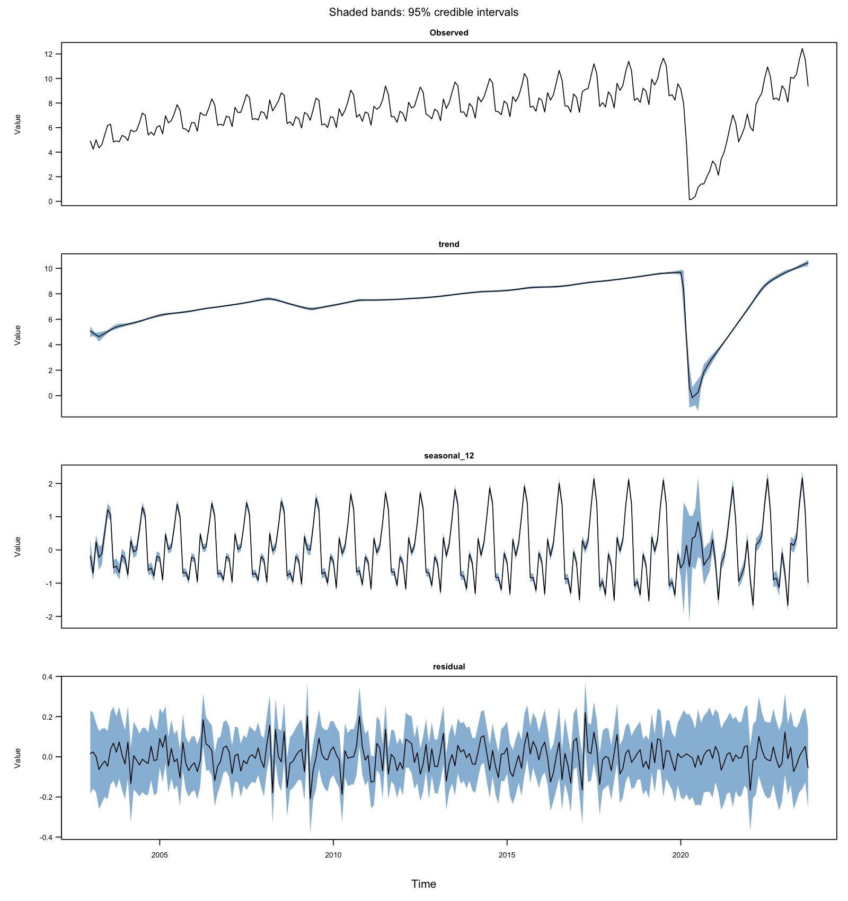
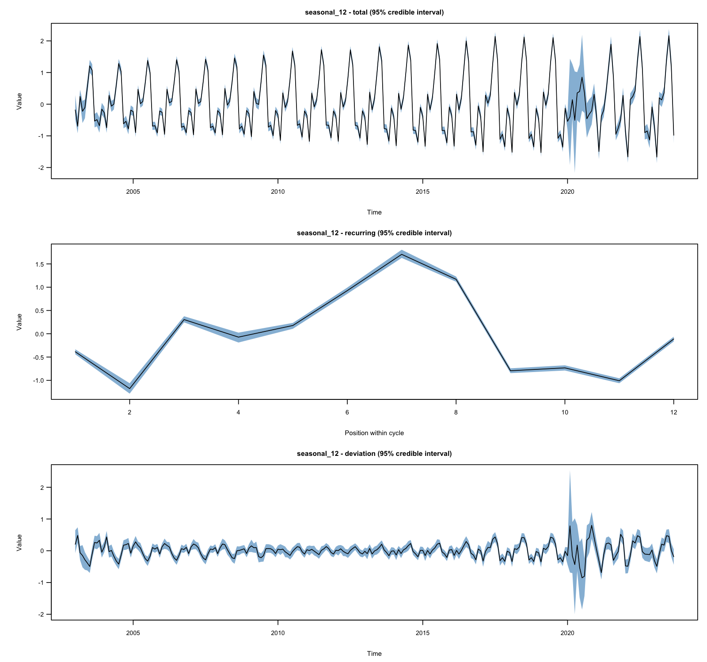
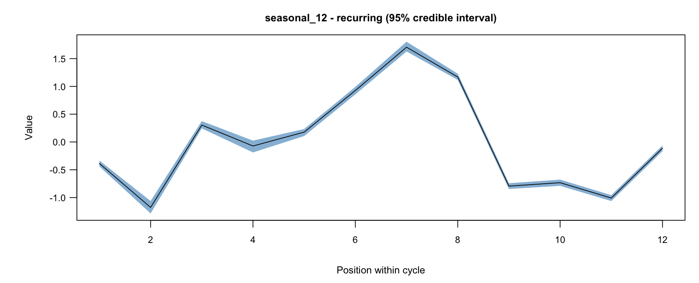
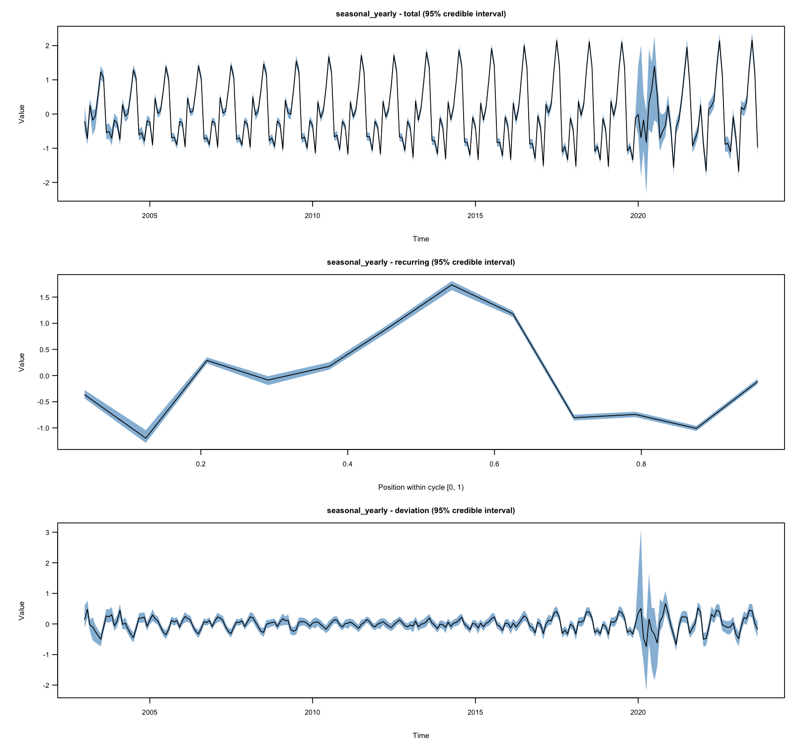

# BASTION

**Bayesian time-series decomposition in R**

BASTION is a flexible Bayesian framework for time-series decomposition. It jointly estimates locally adaptive trends and evolving seasonal patterns, supports multiple seasonalities, and provides uncertainty quantification through posterior credible intervals. Stochastic volatility accounts for heteroskedasticity, while a separate outlier component captures unusual observations.

The accompanying paper was accepted at **AISTATS 2026**.

[Paper](https://proceedings.mlr.press/v300/cho26a.html) · [Preprint](https://arxiv.org/abs/2601.18052) · [Non-technical guide](https://jasoncho0914.github.io/BASTION/articles/non-technical_guide.html) · [Function reference](https://jasoncho0914.github.io/BASTION/reference/index.html)

## Why use BASTION?

- **Local adaptivity:** accommodate smooth movements and abrupt changes in trends and seasonal patterns.
- **Multiple seasonalities:** estimate several recurring patterns together, such as daily and weekly cycles.
- **Uncertainty quantification:** obtain posterior credible intervals for the decomposition components.
- **Heteroskedasticity:** model changing observation variance through stochastic volatility.
- **Outliers:** estimate unusual observations separately from trend and seasonality.

These components are fitted jointly within one Bayesian model. Both fixed-period and calendar-based decompositions support these features, with optional covariates for regression effects.

## Installation

```r
install.packages("remotes")
remotes::install_github("Jasoncho0914/BASTION")
```

## Quick start

The package includes `airtraffic`, a monthly series of international airline passenger traffic in the United States from January 2003 to September 2023.

```r
library(BASTION)
data("airtraffic")

y <- with(airtraffic, ts(
  Int_Pax,
  start = c(Year[1], Month[1]),
  frequency = 12
))

set.seed(100)
fit <- fit_BASTION(
  y = y,
  Ks = list(12),                  # yearly pattern in monthly data
  obsSV = "const",
  Outlier = FALSE,
  nchains = 1,
  nburn = 1000,
  nsave = 1000
)

plot(fit)
```

<p align="center">
  
</p>

`Ks` gives seasonal periods in numbers of observations: `list(12)` for a yearly pattern in monthly data, or `list(24, 168)` for daily and weekly patterns in hourly data.

## Inspect a seasonal pattern

Show the combined seasonality, recurring pattern, and deviation in three panels:

```r
plot_component(fit, "seasonal_12")
```

<p align="center">
  
</p>

To view just the recurring pattern and its credible interval:

```r
plot_component(fit, "seasonal_12", part = "recurring")
```

<p align="center">
  
</p>

The fitted object also provides direct access to component estimates and intervals:

```r
summary(fit)
fit$intervals
fit$seasonality$seasonal_12$recurring
```

## Calendar seasonality

The same airline series can be fitted using its monthly dates and a calendar-year seasonal pattern. `data_unit` describes the observation interval; `seasonalities` describes the repeating cycles.

```r
dates <- with(airtraffic, as.POSIXct(
  sprintf("%04d-%02d-01", Year, Month),
  tz = "UTC"
))

set.seed(100)
fit_calendar <- fit_BASTION_calendar(
  y = airtraffic$Int_Pax,
  dates = dates,
  data_unit = list(unit = "month"),
  seasonalities = list(
    yearly = list(unit = "year")
  ),
  obsSV = "const",
  Outlier = FALSE,
  nchains = 1,
  nburn = 1000,
  nsave = 1000
)

plot_component(fit_calendar, "seasonal_yearly")
```

<p align="center">
  
</p>

Calendar cycles follow the supplied dates, including variable month lengths and leap years. See the [calendar fitter documentation](https://jasoncho0914.github.io/BASTION/reference/fit_BASTION_calendar.html) for intervals, anchors, and further examples.

## Heteroskedasticity and outliers

Set `obsSV = "SV"` to model heteroskedasticity through stochastic volatility, and `Outlier = TRUE` to include a separate outlier component. These options are available in both fitters.

See the [non-technical guide](https://jasoncho0914.github.io/BASTION/articles/non-technical_guide.html) for an introduction and an application to electricity demand.

## Citation

If you use BASTION, please cite:

Cho, J. B. and Matteson, D. S. (2026). **BASTION: A Bayesian Framework for Trend and Seasonality Decomposition.** *Proceedings of the 29th International Conference on Artificial Intelligence and Statistics*, PMLR 300, 4627–4635. [Paper](https://proceedings.mlr.press/v300/cho26a.html).

```bibtex
@inproceedings{pmlr-v300-cho26a,
  title = {BASTION: A Bayesian Framework for Trend and Seasonality Decomposition},
  author = {Cho, Jason B. and Matteson, David S.},
  booktitle = {Proceedings of the 29th International Conference on Artificial Intelligence and Statistics},
  year = {2026},
  volume = {300},
  pages = {4627--4635},
  series = {Proceedings of Machine Learning Research},
  publisher = {PMLR},
  url = {https://proceedings.mlr.press/v300/cho26a.html}
}
```

## Updates

See the [release history](NEWS.md) for changes in each version.
