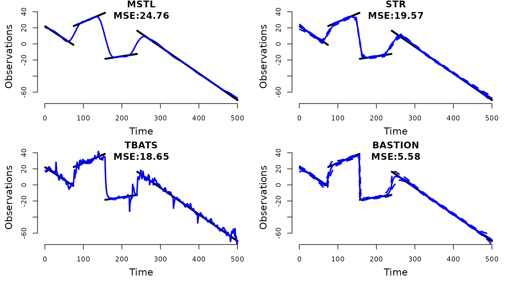

# Time-Series Decomposition with BASTION

## 1. Why BASTION?

**Bayesian Adaptive Seasonality Trend decomposition Incorporating
Outliers and Noise (BASTION)** is a Bayesian framework for decomposing
time series into trend and multiple seasonality. Existing decomposition
methods, though widely used, exhibit several limitations:

1.  Difficulty in adapting to abrupt changes in the trend,
2.  Lack of robustness to outliers and heteroskedasticity
3.  Absence of uncertainty quantification,
4.  Inability to accommodate multiple seasonal patterns,

BASTION is the first Bayesian method to effectively address all these
challenges in a unified framework.

## 2. Example with Simulated Data

Let’s consider following simulated data below:

**Figure
1**: Simulated Data with abrupt changes in trend, outliers, and
heteroskedastic noise term.

BASTION is fitted along with three other existing methods for
comparison:

1.  **TBATS** by (Alysha M. De Livera & Snyder, 2011)
2.  **MSTL** by (Bandara et al., 2021)
3.  **STR** by (Dokumentov & Hyndman, 2022).

``` r
#devtools::install_github("Jasoncho0914/BASTION")
library(BASTION)
#running below takes about 2 ~ 3 minutes total.
set.seed(40)
BASTION_sim = fit_BASTION(y = y[,"y"],
                      Ks = list(7,30),
                      Outlier = TRUE,
                      cl= 0.95,
                      obsSV = "const",
                      nsave = 2000,
                      nburn = 5000)
y_ts <- forecast::msts(y[,"y"], seasonal.periods=c(7,30))
TBATS = forecast::tbats(y_ts)
TBATScomp = forecast::tbats.components(TBATS)
STR = stR::AutoSTR(y_ts,robust = TRUE,confidence = 0.95)
MSTL = forecast::mstl(y_ts)
```

One of the defining characteristic of the simulated data we see above is
the presence of abrupt changes in trend which occur around t = 199, 250,
and 402.

**Figure
2**: The true trend component drawn in black and the estimated trend
component by TBATS, MSTL, STR, and BASTION are drawn in blue. Dotted
lines represent 95 percent confidence intervals for TBATS and credible
regions for STR.

``` r
print(paste0(
  "STR (Empirical Coverage): ",
  sum(as.numeric(STR$output$predictors[[1]]$upper) > y[,"trend"] & 
      as.numeric(STR$output$predictors[[1]]$lower) < y[,"trend"])/length(y[,"trend"])*100,
  "%"))
#> [1] "STR (Empirical Coverage): 78.8%"
print(paste0(
  "BASTION (Empirical Coverage): ",
  sum(as.numeric(BASTION_sim$summary$Trend_sum$CR_upper) > y[,"trend"] & 
      as.numeric(BASTION_sim$summary$Trend_sum$CR_lower) < y[,"trend"])/length(y[,"trend"])*100,
  "%"))
#> [1] "BASTION (Empirical Coverage): 100%"
```

Notice that BASTION provides:

- **Adaptive Trend Estimate**: BASTION successfully capture the abrupt
  changes resulting in the lowest mean squared error (MSE), while also
  providing smooth estimate.
- **Robust Uncertainty Quantification**: BASTION achieves 100 percent
  empirical coverage based on its credible region. Only other existing
  decomposition method that provides uncertainty quantification is STR
  (Dokumentov & Hyndman, 2022), the confidence interval provided by STR
  vastly under-covers with 78.8 percent empirical coverage.

## 3. Daily Electricity Demand in New York State.

Let’s apply BASTION to a real-world dataset by analyzing the average
daily electricity demand (measured in megawatts per hour) for New York
State. This dataset, sourced from the New York Independent System
Operator (NYISO) via the U.S. Energy Information Administration ((EIA),
2024), exhibits a complex long-term trend, intricate seasonal patterns,
and heteroskedastic noise. Through time-series decomposition, we will
demonstrate how BASTION effectively reveals underlying patterns that are
otherwise obscured by noise.

    #> Welcome to BASTION!

**Figure
3**: Daily average electricity demand in New York State from July 1,
2015, to June 30, 2024. The data represent the average hourly
electricity demand for each day, aggregated from hourly observations.

Based on the raw data, we see the following:

- **Seasonal Patterns**: Electricity demand peaks during summer months
  due to air conditioning and rises again in winter for heating needs.
- **Heteroskedasticity**: Variability is higher in summer and winter
  (periods of peak demand) and lower during spring and fall (more stable
  usage).
- **Long-Term Trends**: No significant long-term trend is observed in
  electricity demand. A slight overall decline may indicate the
  influence of improved energy efficiency over the years.

### 3.1 Decomposition with BASTION

**Figure
4**: Decomposition of the trend, weekly seasonality, yearly seasonality,
and volatility using BASTION for daily average electricity demand from
July 1, 2015, to June 30, 2024. Dark grey regions represent the 95%
credible intervals. To enhance clarity, weekly seasonality is displayed
for the period April 1, 2016, to July 1, 2016.

Notice that BASTION reveals patterns that are not apparent in the raw
data:

- **Trend Component**:
  - A noticeable dip is observed during the winter of 2015–2016, driven
    by a warmer-than-usual winter caused by a strong El Niño effect,
    which reduced heating needs.
  - From January 2016 to April 2016, electricity demand steadily
    increased, likely due to a colder-than-usual spring in early 2016
    that extended heating needs.
  - During the summer of 2016, electricity demand peaked, reflecting
    increased air conditioning usage during one of the hottest summers
    on record.
  - A noticeable dip in late 2019 likely reflects the impact of
    COVID-19-related shutdowns.
- **Seasonality**:
  - In addition to the yearly seasonal pattern driven by weather, weekly
    pattern reveals that electricity demand is steady on weekdays and
    decreases on weekends, consistent with common usage patterns.
- **Volatility**:
  - BASTION’s time-varying volatility estimate highlights
    heteroskedasticity in the noise term, with volatility also
    exhibiting seasonal patterns.
  - Higher volatility is observed in winter months, while lower
    volatility occurs during summer, closely aligning with the yearly
    seasonality pattern.
  - BASTION uniquely models volatility directly, providing insights that
    other decomposition methods cannot.

### 3.2 Comparisons to Other Models

I would like to direct our attention to the yearly seasonal estimates in
comparison with the ones produced by the three existing models.
**Figure
5**: Yearly seasonality estimates for daily average electricity demand
in New York from July 2015 to June 2017. Estimates from TBATS, MSTL,
STR, and BASTION are displayed respectively.

- **Overall Seasonal Patterns**: All methods (BASTION, MSTL, STR, and
  TBATS) capture the East Coast’s seasonal patterns, including peak
  demand in summer (July and August) due to cooling needs, a decline in
  fall as temperatures moderate, and a rise in winter reflecting heating
  requirements.

- **Holiday Season Effect**: BASTION and MSTL detect a 30-day dip in
  demand (mid-December to mid-January) during the holiday season,
  reflecting reduced commercial and industrial activity.

- **BASTION’s Strength**: BASTION excels at detecting subtle seasonal
  changes while maintaining smooth, accurate estimates of components.

## 4. Conclusion

BASTION effectively addresses the limitations of existing time-series
decomposition methods by providing adaptive trend estimation, robust
handling of outliers, and direct modeling of volatility. Its ability to
capture nuanced seasonal patterns and abrupt changes in the data makes
it a valuable tool for real-world applications.

For technical details of BASTION, see the [main
paper](https://jasoncho0914.github.io/pdf/BASTION_20250124.pdf).

## References

Alysha M. De Livera, R. J. H., & Snyder, R. D. (2011). Forecasting time
series with complex seasonal patterns using exponential smoothing.
*Journal of the American Statistical Association*, *106*(496),
1513–1527. <https://doi.org/10.1198/jasa.2011.tm09771>

Bandara, K., Hyndman, R. J., & Bergmeir, C. (2021). *MSTL: A
seasonal-trend decomposition algorithm for time series with multiple
seasonal patterns*. <https://arxiv.org/abs/2107.13462>

Dokumentov, A., & Hyndman, R. J. (2022). STR: Seasonal-trend
decomposition using regression. *INFORMS Journal on Data Science*,
*1*(1), 50–62. <https://doi.org/10.1287/ijds.2021.0004>

(EIA), U. S. E. I. A. (2024). *New york independent system operator
electricity demand data*.
<https://www.eia.gov/electricity/gridmonitor/dashboard/electric_overview/regional/REG-NY>
